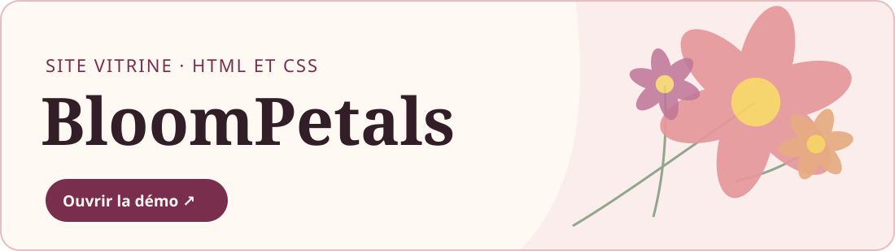

<h1 align="center">Salut, moi c’est Walid ! 👋</h1>

<p align="center">🎓 <b>En formation à La Plateforme_</b> | 💡 <b>Sites vitrines en HTML/CSS et algorithmique en Python</b></p>

<p align="center"><i>Python | HTML | CSS | Git | GitHub Pages | JavaScript (en cours)</i></p>

<p align="center">
  
</p>

<p align="center">
  
</p>

Bienvenue sur mon profil ! Je me forme au développement logiciel à La Plateforme_. Je construis des sites statiques en HTML et CSS, je pratique l’algorithmique en Python et j’apprends maintenant JavaScript. Chaque projet ci-dessous est en ligne ou lisible dans son dépôt.

---

## 🛠️ Technologies et outils

<p align="center">
  
</p>

---

## 🧠 Compétences

<table align="center">
  <tr>
    <th>Je maîtrise</th>
    <th>J’apprends</th>
    <th>Mes éditeurs</th>
  </tr>
  <tr>
    <td align="center"></td>
    <td align="center"></td>
    <td align="center"><br /><br /></td>
  </tr>
</table>

---

## 💻 Les éditeurs que j’aime

<p align="center">
  
  
</p>

---

## 🚀 Projets

<table>
  <tr>
    <td width="50%" valign="top">
      <a href="https://walidboussaha.github.io/runtrack-html/BloomPetals/"></a>
      <h3>🌸 BloomPetals</h3>
      <p>Site vitrine de fleuriste en quatre pages : galerie, présentation de l’équipe et formulaire de démonstration.</p>
      <p> </p>
      <p><a href="https://walidboussaha.github.io/runtrack-html/BloomPetals/">Ouvrir le site ↗</a> · <a href="https://github.com/walidboussaha/runtrack-html/tree/main/BloomPetals">Code</a></p>
    </td>
    <td width="50%" valign="top">
      <h3>📄 CV web</h3>
      <p>Page responsive en HTML sémantique, avec navigation par ancres et intégration vidéo.</p>
      <p><a href="https://walidboussaha.github.io/runtrack-html/CV/mon-cv.html">Ouvrir le CV ↗</a> · <a href="https://github.com/walidboussaha/runtrack-html/tree/main/CV">Code</a></p>
      <h3>🐍 Runtrack Python</h3>
      <p>62 scripts en six séries, des premiers scripts aux algorithmes sur les listes et les chaînes.</p>
      <p><a href="https://github.com/walidboussaha/runtrack-python">Guide</a> · <a href="https://github.com/walidboussaha/runtrack-python/blob/master/jour7%268pr/job08.py">Tri manuel</a> · <a href="https://github.com/walidboussaha/runtrack-python/blob/master/jour7%268pr/job04.py">Chiffrement de César</a></p>
      <h3>🌱 Git Begins</h3>
      <p>Premiers exercices Git et mémo des commandes : cloner, committer, synchroniser.</p>
      <p><a href="https://github.com/walidboussaha/git-begins">Ouvrir le dépôt</a></p>
    </td>
  </tr>
</table>

---

## 📊 Mes stats GitHub

<p align="center">
  
  
</p>

<p align="center">
  
</p>

<p align="center">
  
</p>

---

## 🏆 Trophées GitHub

<p align="center">
  
</p>

---

## 🌟 Restons en contact !

Je suis toujours partant pour échanger sur un projet ou une idée. Tu peux me trouver ici :

<p>
  <a href="https://github.com/walidboussaha"></a>
  <a href="https://github.com/swayvfilms"></a>
  <a href="https://walidboussaha.github.io/runtrack-html/"></a>
</p>

---

## 🎉 Fun fact

J’ai codé un chiffrement de César en Python : tu peux le lire dans [job04.py](https://github.com/walidboussaha/runtrack-python/blob/master/jour7%268pr/job04.py). 🔐

```python
#!/usr/bin/python
# -*- coding: utf-8 -*-
class Developpeur:

    def __init__(self):
        self.nom = "Walid Boussaha"
        self.role = "Développeur en formation"
        self.ecole = "La Plateforme_"
        self.langages = ["Python", "HTML", "CSS"]
        self.apprend = ["JavaScript"]
        self.editeurs = ["VS Code", "Xcode"]

    def dire_bonjour(self):
        print("Merci de passer sur mon profil ! 👋")


moi = Developpeur()
moi.dire_bonjour()
```

---

## 😂 La blague du jour

<p align="center">
  
</p>

---

## 📺 Mon temps libre

<p align="center">
  
</p>
