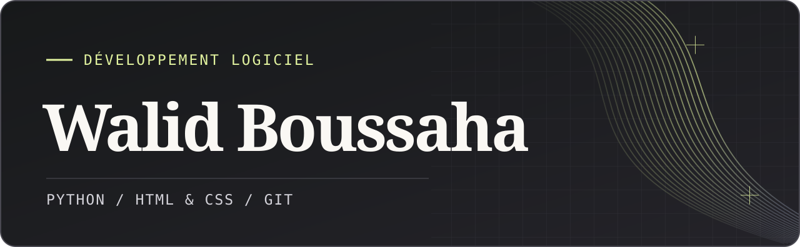

[**Voir les démonstrations ↗**](https://walidboussaha.github.io/runtrack-html/) · [Explorer les dépôts](https://github.com/walidboussaha?tab=repositories) · [Swayv Films](https://github.com/swayvfilms)

Je développe en **Python**, **HTML/CSS** et **Git**. Ce portfolio rassemble les projets que j’ai réalisés à **La Plateforme_**, avec des démos à essayer et des fichiers précis pour explorer le code.

## Projets de formation

| Projet | Ce que j’ai réalisé | Démo et code |
| --- | --- | --- |
| **BloomPetals** | Site vitrine de fleuriste en quatre pages, avec galerie, présentation de l’équipe et formulaire de démonstration. | [Démo](https://walidboussaha.github.io/runtrack-html/BloomPetals/) · [Code](https://github.com/walidboussaha/runtrack-html/tree/main/BloomPetals) |
| **CV web** | Page responsive en HTML sémantique, avec navigation par ancres et intégration vidéo. | [Démo](https://walidboussaha.github.io/runtrack-html/CV/mon-cv.html) · [Code](https://github.com/walidboussaha/runtrack-html/tree/main/CV) |
| **Runtrack Python** | 62 scripts en six séries, dont un tri manuel et un chiffrement de César. | [Guide et exemples](https://github.com/walidboussaha/runtrack-python) |
| **Git Begins** | Premiers exercices de versionnage et mémo de commandes Git. | [Dépôt](https://github.com/walidboussaha/git-begins) |

## À lire dans le code

- **Intégration web** · [Structure de BloomPetals](https://github.com/walidboussaha/runtrack-html/blob/main/BloomPetals/index.html) et [feuille de style](https://github.com/walidboussaha/runtrack-html/blob/main/BloomPetals/style.css)
- **Algorithmique** · [Tri manuel](https://github.com/walidboussaha/runtrack-python/blob/master/jour7%268pr/job08.py) et [chiffrement de César](https://github.com/walidboussaha/runtrack-python/blob/master/jour7%268pr/job04.py)
